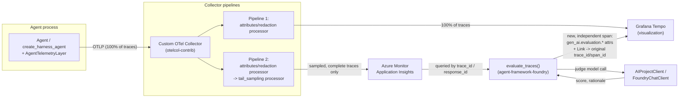

# Architecture A — Azure AI Foundry Evaluations + App Insights

Use this option when the judge itself should be Azure AI Foundry's built-in evaluators
(relevance, coherence, task adherence, or custom rubric evaluators) rather than a
self-hosted judge service. App Insights is in this pipeline for exactly one reason: it's
what Foundry's evaluation SDK reads traces *from*.

## SDKs / components involved

| Role | Concrete package / API |
|---|---|
| Agent instrumentation | `agent_framework.observability.configure_otel_providers()` (already in this repo) |
| Collector | standalone `otelcol-contrib` (OpenTelemetry Collector Contrib) |
| App Insights exporter (in the Collector) | `azuremonitor` exporter (`azuremonitorexporter` component, from `opentelemetry-collector-contrib`) |
| Trace-consistent sampling (in the Collector) | `tail_sampling` processor |
| Judge / evaluation SDK | `agent_framework.foundry.evaluate_traces()` (package `agent-framework-foundry`) |
| Judge's Azure client | `azure.ai.projects.AIProjectClient` (package `azure-ai-projects`) |
| Judge's model access | `agent_framework.foundry.FoundryChatClient`, or a `model=` deployment name passed directly to `evaluate_traces()` |
| Visualization | Grafana + Tempo, via OTLP |

`evaluate_traces()` is explicitly marked **Experimental** in the SDK — expect its signature
to shift across `agent-framework-foundry` releases.

## Diagram

## Flow, step by step

1. The agent process exports every trace via OTLP to the Collector — no sampling decision
   is made in-process.
2. The Collector runs two pipelines off the same receiver:
   - **Pipeline 1** forwards 100% of traces to Grafana Tempo, for visualization.
   - **Pipeline 2** applies `tail_sampling` (buffers per `trace_id`, forwards a trace only
     once it's complete) before exporting the sampled subset to App Insights via the
     `azuremonitor` exporter.
3. `evaluate_traces()` queries App Insights for the traces it should score — by
   `trace_ids=[...]`, `response_ids=[...]`, or `agent_id` + `lookback_hours` for recent
   activity.
4. The evaluator LLM call goes through `AIProjectClient` (or a `FoundryChatClient`), scoring
   each trace against the configured evaluators (e.g. `FoundryEvals.RELEVANCE`).
5. For each result, a new span is emitted in its **own, independent trace** — carrying
   `gen_ai.evaluation.*` attributes plus a span **Link** back to the original trace/span, and
   a `gen_ai.evaluation.source_trace_id` attribute for TraceQL lookups — then exported to
   Grafana. See
   [the consolidating doc's correlation section](./observability-llm-judge.md#-important-do-not-inject-the-eval-span-into-the-original-trace)
   for why it's a linked, separate trace rather than injected into the original one: Tempo
   accepts late spans on an existing `trace_id`, but doing that for every sampled trace,
   continuously, fragments each one across multiple storage blocks and adds ongoing
   compaction/query overhead.

## Tradeoff vs. Architecture B

You take on App Insights ingestion cost, an extra hop, and a dependency on
`agent-framework-foundry` + `azure-ai-projects` — in exchange for Foundry's pre-built,
maintained evaluators instead of writing and maintaining your own judge prompts/scoring
logic. If you don't intend to use Foundry's evaluators specifically, this entire App Insights
leg is unnecessary — see [Architecture B](./architecture-custom-judge.md).
