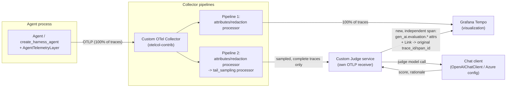

# Architecture B — Custom Judge, No App Insights

Use this option when the judge is a self-hosted service (your own prompt, your own scoring
rubric, any model you choose) rather than Azure AI Foundry's built-in evaluators. Since
nothing here needs to *query* App Insights, App Insights is dropped entirely — the sampled
traces go straight from the Collector to your judge service.

## SDKs / components involved

| Role | Concrete package / API |
|---|---|
| Agent instrumentation | `agent_framework.observability.configure_otel_providers()` (already in this repo) |
| Collector | standalone `otelcol-contrib` (OpenTelemetry Collector Contrib) |
| Trace-consistent sampling (in the Collector) | `tail_sampling` processor |
| Judge receiver | your own OTLP receiver (e.g. `opentelemetry-collector`'s `otlp` receiver embedded in your service, or any OTLP-compatible ingest endpoint) |
| Judge's model access | any chat client — e.g. `agent_framework.openai.OpenAIChatClient` / `AzureOpenAIChatClient`-style Azure config, called directly by your judge service |
| Eval span emission | `opentelemetry-sdk` — new independent trace, with a `Link` (`opentelemetry.trace.Link`) back to the original `SpanContext` |
| Visualization | Grafana + Tempo, via OTLP |

## Diagram

## Flow, step by step

1. The agent process exports every trace via OTLP to the Collector — identical to
   Architecture A, no sampling decision is made in-process.
2. The Collector runs the same two pipelines:
   - **Pipeline 1** forwards 100% of traces to Grafana Tempo, for visualization.
   - **Pipeline 2** applies `tail_sampling` (buffers per `trace_id`, forwards a trace only
     once it's complete), then exports the sampled subset directly to your judge service's
     own OTLP receiver — no App Insights hop in between.
3. Your judge service receives complete, sampled traces, extracts whatever it needs (prompt,
   response, tool calls — captured as span attributes if `ENABLE_SENSITIVE_DATA` is on),
   and calls an LLM directly with your own judge prompt/rubric.
4. For each result, your service starts a **new, independent span/trace** (a normal
   `tracer.start_as_current_span("gen_ai.evaluate", links=[Link(original_span_context)])`),
   carrying `gen_ai.evaluation.*` attributes plus a `gen_ai.evaluation.source_trace_id`
   attribute pointing back to the original trace.
5. That span is exported to Grafana as its own trace, with a navigable Span Link back to the
   original trace. See
   [the consolidating doc's correlation section](./observability-llm-judge.md#-important-do-not-inject-the-eval-span-into-the-original-trace)
   for why: injecting into the original trace's `trace_id` after it's already flushed works in
   Tempo, but doing it for every sampled trace continuously fragments each one across multiple
   storage blocks and adds ongoing compaction/query overhead — a Link-based separate trace
   avoids that entirely while still giving one-click navigation between the two in Grafana.

## Tradeoff vs. Architecture A

You own the judge prompt, scoring logic, and model choice completely — but you also own
building and maintaining that judge service, instead of getting Foundry's maintained
evaluators for free. No App Insights ingestion cost, no extra hop, no dependency on
`agent-framework-foundry` / `azure-ai-projects`. If you later want Foundry's evaluators as
an *additional* judge source, App Insights would need to be reintroduced only for that leg —
see [Architecture A](./architecture-azure-evaluations.md).
