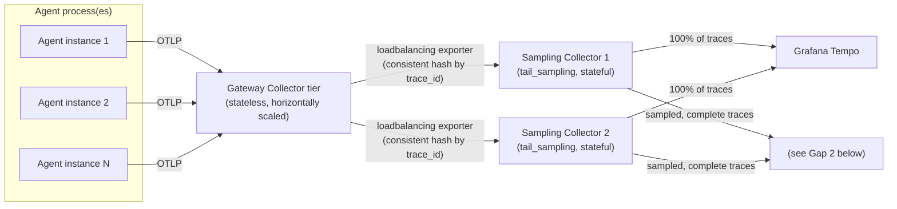
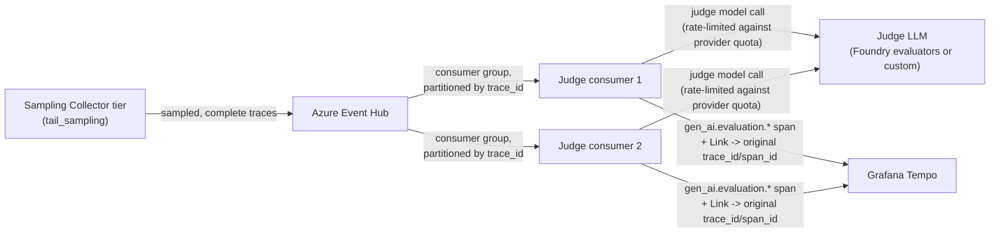

# Scaling for High-Volume Traffic

Both architecture options ([A](./architecture-azure-evaluations.md),
[B](./architecture-custom-judge.md)) hold up as designed for the visualization leg — Grafana
Tempo is built for high-volume OTLP ingest and scales its distributor/ingester/compactor tiers
independently. The eval leg has two gaps that only show up under real production traffic,
covered here.

## Gap 1 — `tail_sampling` breaks under naive Collector scaling

`tail_sampling` needs every span belonging to one trace to land on the **same** Collector
instance, since it buffers spans in memory until a trace looks complete before deciding
whether to forward it. Scale the Collector to multiple replicas behind a plain load balancer
and a single trace's spans can be split across instances — each replica sees a partial trace
and either double-samples it or misses it entirely. `tail_sampling` silently stops doing what
you configured it to do.

**Fix: a two-tier Collector, with trace-aware routing between the tiers.** A stateless
gateway tier receives everything from your apps, then uses the Collector's
**`loadbalancing` exporter** — which consistent-hashes by `trace_id` — to route all of one
trace's spans to the same instance in a horizontally-scaled `tail_sampling` tier.

This tier only becomes necessary once a single Collector's memory/throughput can't keep up
with your trace volume — don't add it preemptively, add it when the single-instance Collector
becomes the bottleneck.

## Gap 2 — the judge, not the pipeline, is the real bottleneck

Each sampled trace costs an actual LLM call to score it (seconds, not milliseconds), and your
model provider has its own rate/token limits — a ceiling far lower than your trace volume
ceiling. If the sampled pipeline exports directly to the judge's receiver, a traffic spike
either overwhelms the judge (dropped evaluations) or backs up into the Collector's export
queue — risking the tracing pipeline itself, not just the eval leg.

**Fix: put Azure Event Hub between "sampled and complete" and "the judge consumes it."**
This decouples burst trace volume from sustainable judge throughput: Event Hub absorbs the
spike, judge consumers drain at whatever pace the LLM provider's rate limit allows, and a
failed judge run can retry/replay from the stream without needing the original trace data to
still be live anywhere else.

This applies differently depending on which architecture you picked:

- **Architecture B (custom judge):** Event Hub carries the actual sampled span payloads (or
  enough of them — prompt/response/tool-call attributes) directly to your judge consumers,
  which own their own concurrency/rate-limiting against the LLM provider. This is the case
  the diagram above shows directly.
- **Architecture A (Foundry `evaluate_traces()`):** the LLM-throughput bottleneck is already
  managed *inside* Azure's evaluation service — `evaluate_traces()` is itself an async
  submit-and-poll job, not something you call once per trace in real time. Event Hub's role
  shifts here: instead of carrying full span payloads, it carries lightweight
  "trace `X` just landed in App Insights, ready to evaluate" events. A small consumer service
  batches those into periodic `evaluate_traces(trace_ids=[...])` calls, replacing a blind
  `lookback_hours` polling loop with an event-driven trigger — Event Hub is buffering
  *when to submit*, not the LLM call itself.

## When to reach for either fix

Neither of these is a day-one requirement — both architecture docs describe the pattern that
works at moderate volume without them. Add the two-tier Collector when a single Collector
instance can't hold your trace throughput/memory footprint; add Event Hub when your sampled
rate approaches (or bursts past) what your judge — self-hosted or Foundry-managed — can
sustainably process.
